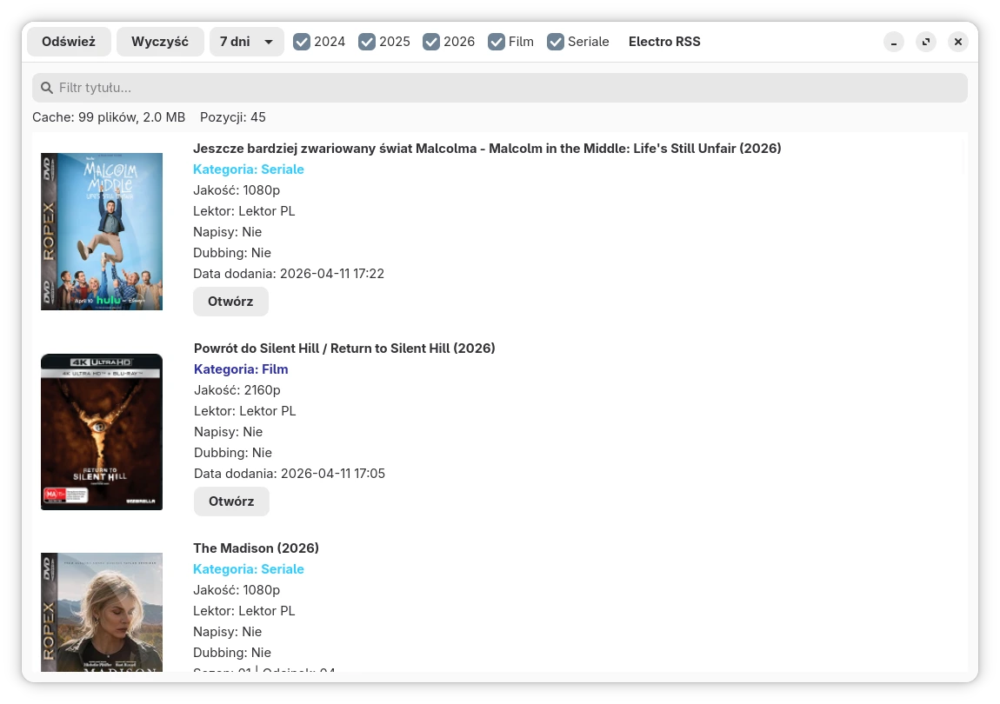

# Electro RSS (Rust)

A desktop application for browsing the latest releases from electro-torrent.pl using RSS.

I'm lazy, and I don't feel like browsing the entire website looking for releases from 2024, 2025, and 2026. Those are the only ones I'm interested in. If you're as lazy as I am, this application will do the work for you.

This is an improved version of my previous Python project:
- Faster performance
- GTK4 / libadwaita GUI
- Data caching and thumbnails
- Filtering by year and category



## Features

- RSS feed parser (no API required)
- Filtering by:
  - Title
  - Year (2024 / 2025 / 2026)
  - Category (Movies / TV Series)
- Data and thumbnail caching
- Cache statistics (size / item count)
- Open links in your default web browser

## Requirements

### Fedora
```bash
sudo dnf install gtk4-devel libadwaita-devel openssl-devel pkgconf-pkg-config gcc clang
```

### Debian / Ubuntu
```bash
sudo apt install libgtk-4-dev libadwaita-1-dev pkg-config build-essential
```

### Arch Linux
```bash
sudo pacman -S gtk4 libadwaita base-devel
```

## Build

```bash
cargo build --release
```

## Run

Development:
```bash
cargo run
```

Release:
```bash
./target/release/electro-rss-rust
```

## Cache

Data and thumbnails are stored in:

```bash
~/.cache/electro_rss_rust/
```
